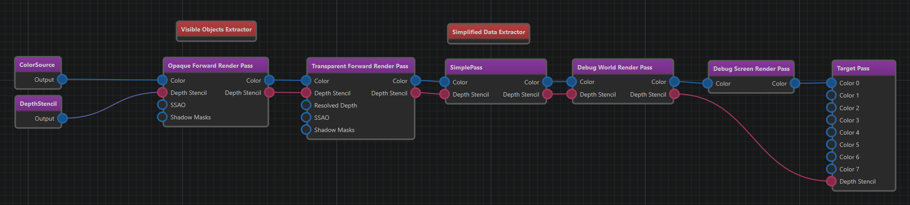
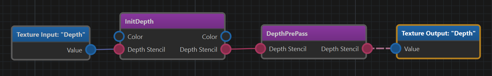
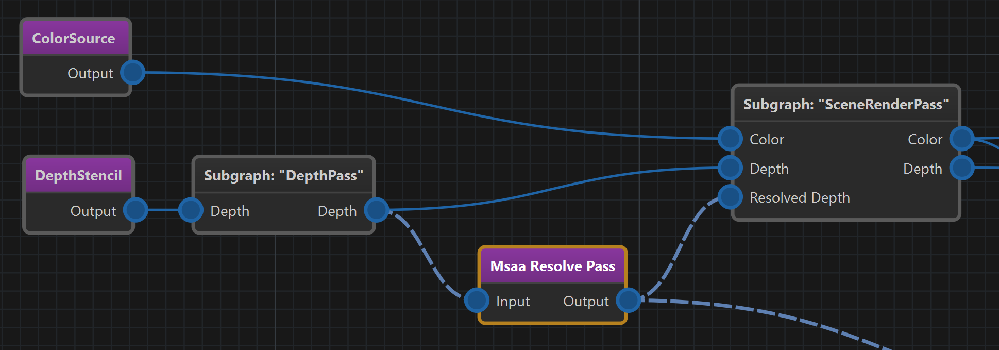
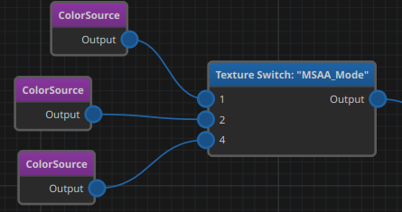
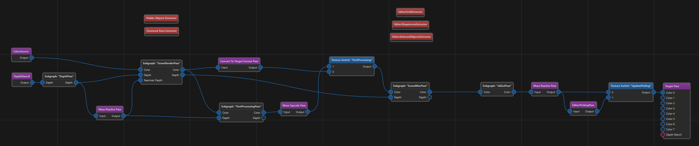
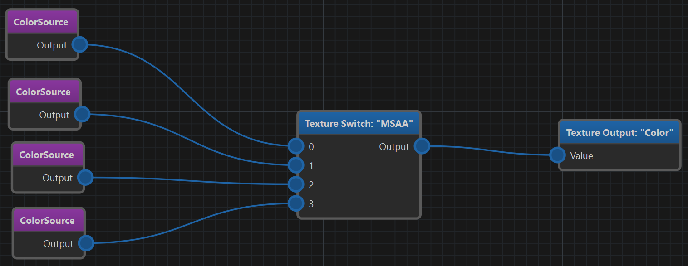

# Configurable Render Pipelines

*October 2026*

Over the course of 2026, the render pipeline infrastructure in EZ went through a series of larger changes. Each of them was useful on its own, but together they changed how we build and configure render pipelines quite a bit. This article gives an overview of the changes. For the latest documentation, see the [render pipeline](../docs/graphics/render-pipeline/render-pipeline-overview.md) pages.

## Where We Came From

A [render pipeline](../docs/graphics/render-pipeline/render-pipeline-overview.md) in EZ has always been a graph that you edit visually: passes on the left produce render targets, passes further right consume them, and eventually everything ends up in a *Target Pass*. That part is very flexible. What was not flexible was everything that happens *after* you hit save.

Once a pipeline was set up, it pretty much stayed that way. If a game wanted a graphics option to turn SSAO off, someone had to write C++ code that finds the pass in the pipeline and flips its *Active* flag. And a disabled pass didn't really go away, either. It still had to provide *something* on its outputs, so that the passes behind it would keep working.

Changing MSAA was even worse. The sample count is decided by the passes that create the color and depth targets, so switching it essentially meant using a different pipeline asset.

And then there was the copy-paste problem. The main pipeline (used by games) and the editor pipeline share most of their logic: depth pre-pass, opaque and transparent geometry, sky, post-processing. But they were separate assets, so every improvement had to be done twice, and inevitably they drifted apart.

## The Foundation: The Render Graph

The first big step had nothing to do with configurability. In June we introduced the [render graph](../docs/graphics/render-graph/render-graph.md). Instead of executing GPU work immediately, each render pass now *records* what it wants to do: which textures and buffers it reads and writes, and a callback that does the actual work later. The render graph then looks at the whole frame at once:

* It culls passes whose output nobody uses.
* It allocates transient textures and shares memory between textures whose lifetimes don't overlap.
* It figures out all the resource barriers, which is a big deal for Vulkan.

This was a breaking change for everyone who wrote custom render passes, but it gave us a clean, declarative description of each frame. Without it, much of what follows would have been a lot harder.

## Blackboards Instead of Code

The second piece came in July: render pipeline properties can now be driven through [blackboards](../docs/misc/blackboards.md). Every world has a blackboard, and every view can have its own. An entry named `TonemapPass.Saturation` overrides the *Saturation* property of the pass named *TonemapPass*. No C++ needed.

This also made the old *post processing component* redundant. The [volume sampler component](../docs/gameplay/volume-sampler-component.md) can now write the values it samples into a blackboard, so things like color grading change smoothly when the camera moves through a level.

Blackboards turned out to be the perfect *data channel* into the pipeline. That paved the way for the next step.

## Sub-Graphs

In September the pass graph got rewritten from scratch, and with that came **sub-graphs**. A render pipeline asset can now be placed inside another render pipeline asset as a single *Subgraph* node. Inside the referenced pipeline, special boundary nodes (*Texture Input*, *Texture Output* and their buffer variants) define which pins the subgraph node shows on the outside.

For example, this is the *DepthPass* subgraph. It takes a depth target as input, primes it in the *InitDepth* pass and runs the depth pre-pass. The result is exposed through a *Texture Output* node named *Depth*:

And this is what such a subgraph looks like when it is used elsewhere. It shows up as a single node with *Depth* input and output pins:

Subgraphs only exist in the editor. During asset transform they are inlined, so at runtime there is no difference to a pipeline that contains all passes directly. You don't pay anything for the extra structure.

## Switch Nodes

The same rework also introduced the **switch passes**. A *Texture Switch* (or *Buffer Switch*) has several inputs and one output. It reads an integer value from a blackboard entry and forwards the input that matches that value:

The interesting part is what happens to everything that is *not* selected. Because the pass graph knows which passes feed which inputs, every pass that only feeds unselected inputs is culled from the pipeline entirely. It is not just skipped, it is not part of the frame at all. No render targets get allocated for it, and nothing needs to produce a dummy output.

This also means the pass graph itself can now be **immutable**. Instead of toggling individual passes at runtime, the pipeline asset describes all variants up front, and switches pick one. When a switch value changes, the pass graph gets culled and sorted again. That is not something you'd want to do every frame, but for configuration changes it is cheap enough.

So the old way of deactivating passes was removed. If you want something to be optional, you route around it with a switch.

## Putting It Together

Once subgraphs and switches were in place, it was time to clean up our own pipelines. The shared parts were moved into subgraphs, which live in `Data/Base/RenderPipelines/Subgraphs`:

* **Sources:** creates the color and depth targets.
* **DepthPass:** depth priming and depth pre-pass.
* **SceneRenderPass:** SSAO, screen space shadows, opaque, sky and transparent geometry.
* **PostProcessingPass:** anti-aliasing, bloom, light shafts, lens effects and tonemapping.
* **SceneMiscPass** and **2dGuiPass**: various things that are rendered on top.

The main and the editor pipeline now both use these subgraphs and only differ in the parts that are actually different. This is the editor pipeline:

The editor uses two switches here. One skips post-processing when you look at one of the debug [render modes](../docs/editor/editor-views.md) (you don't want tonemapping on your normals). The other only runs the picking pass when picking data actually needs to be updated. Previously the editor had a whole separate debug pipeline for this, which is now gone.

### Graphics Settings Through CVars

Now, who sets the switch values? We wanted graphics settings to be available as [CVars](../docs/debugging/cvars.md), because they can be changed from the console, get saved automatically, and are easy to bind to a UI. So we added a small bridge: every CVar whose name starts with `Rendering.Pipeline.` is automatically copied into the world blackboard, and kept up to date when it changes.

That means adding a new graphics option to a pipeline boils down to:

1. Declare a CVar named `Rendering.Pipeline.Something`.
1. Put a switch into the pipeline that reads `Rendering.Pipeline.Something`.

Nothing else. Out of the box we have these:

* `Rendering.Pipeline.SSAO`: selects between *off*, the default AO pass and LSAO. Inside the *SceneRenderPass* subgraph a switch picks the output of one of the AO passes, or no AO at all.
* `Rendering.Pipeline.SSS`: toggles screen space shadows.
* `Rendering.Pipeline.MSAA`: selects off, 2x, 4x or 8x MSAA.

The same trick works for properties, by the way. Since the SSAO pass is named `Rendering.Pipeline.SSAO`, the CVar `Rendering.Pipeline.SSAO.MaxScreenSpaceRadius` directly sets one of its properties.

### MSAA

MSAA was the trickiest one, because it isn't a single pass that can be turned on or off. It affects how the render targets are created at the very beginning, and every pass that touches them afterwards.

The solution is in the *Sources* subgraph. It contains one color and one depth source for each MSAA mode, eight source passes in total, and two switches pick the color and depth target for the selected mode. Thanks to culling, only the selected sources ever create a texture.

The passes that deal with MSAA, such as the *MSAA Resolve Pass*, now simply pass their input through when they receive a texture that isn't multi-sampled. So the rest of the pipeline doesn't need to know which mode is active. The resolve pass also got a *Guarantee Copy* option for cases where the output must be a separate texture, even without MSAA.

With all of that in place, the [RmlUi main menu component](../docs/ui/rmlui-main-menu-component.md) got options for SSAO, screen space shadows and MSAA. All they do is set a CVar.

## Bonus Improvement: Render Scale

One more thing that landed along the way is the [render scale](../docs/graphics/render-pipeline/render-pipeline-overview.md#render-scale). Rendering at native 4K is expensive, so the main pipeline now renders the scene at a lower resolution and upscales the result at the end, optionally with a sharpening filter. By default the scale is picked such that the scene has about as many pixels as a full HD image. The UI is rendered after the upscale pass, so it stays sharp. The scale is set through the CVar `App.RenderScale`.

## Wrapping Up

None of this is visible in a game screenshot, but it changed how we can work with render pipelines. The main and editor pipelines share their logic, graphics options are now easy to configure and unused features cost nothing at runtime.

## See Also

* [Render Pipeline](../docs/graphics/render-pipeline/render-pipeline-overview.md)
* [Render Pipeline Passes](../docs/graphics/render-pipeline/render-pipeline-passes.md)
* [Render Pipeline Properties](../docs/graphics/render-pipeline/render-pipeline-properties.md)
* [Render Graph](../docs/graphics/render-graph/render-graph.md)
* [CVars](../docs/debugging/cvars.md)
