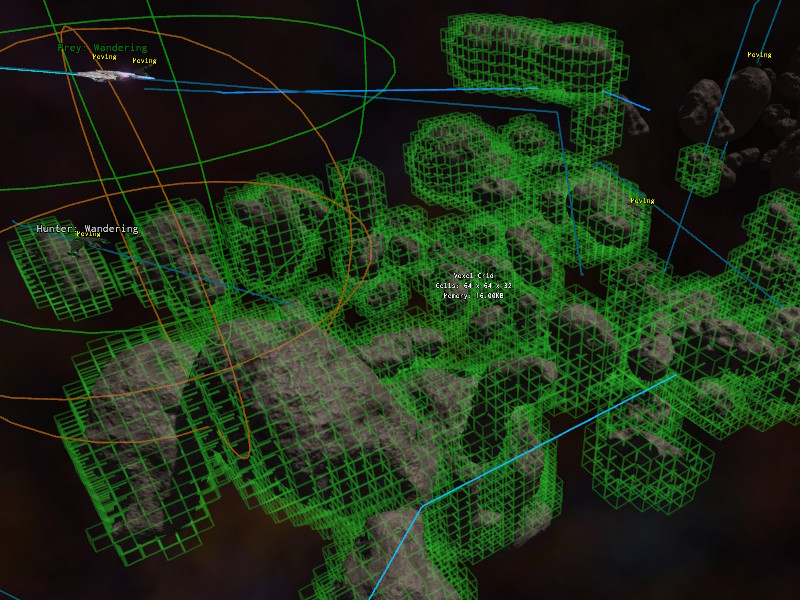
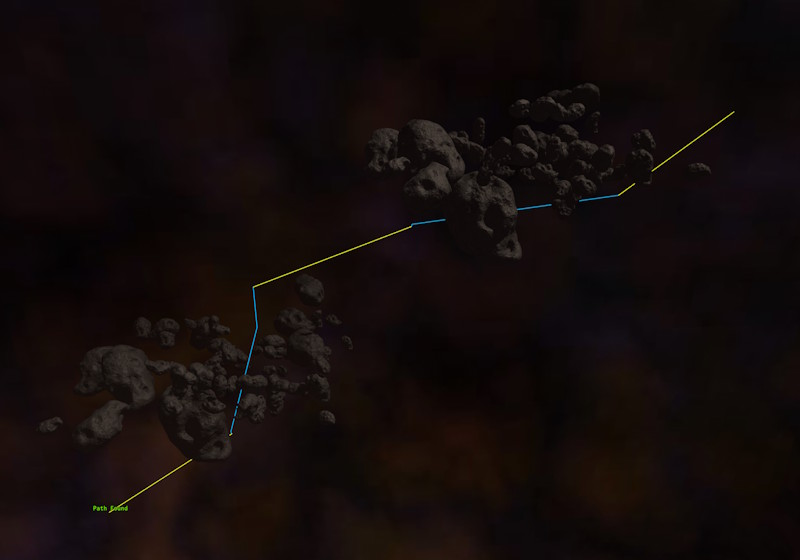

# 3D Voxel Navigation

Voxel navigation is used for objects that move freely through 3D space, such as flying creatures, submarines or spaceships. Whereas the [runtime navmesh](runtime-navmesh.md) describes walkable surfaces, a voxel grid describes which parts of the *volume* are blocked and which are free.

## Voxel Grids

The navigable space is described by one or more [voxel grid components](voxel-grid-component.md). Each grid is a box of a fixed size that is subdivided into voxels of a fixed edge length. Once the scene starts simulating, the collision geometry inside the box is rasterized into the grid, and every voxel that is touched by a triangle is marked as *occupied*. All other voxels are *free*.

Only geometry of the [collision layer](../../physics/jolt/collision-shapes/jolt-collision-layers.md) that is configured on the grid is taken into account, which allows you to exclude detail geometry or objects that should not block navigation.

Voxelization happens once, a few frames after the simulation started. It is not updated afterwards, so objects that move at runtime don't affect the grid.

Grids are managed by the `ezAiVoxelWorldModule`. Its `IsReady()` function returns true once voxelization has finished. Before that, path searches fail. The module also provides `FindGridsInBox()` to find all grids in an area.

### Caves and Enclosed Spaces

To build caves and tunnels in the editor, a [terrain volume](../../terrain/terrain-volume-component.md) can be carved with [3D terrain brushes](../../terrain/terrain-brush-3d-component.md). The terrain volume generates a collision mesh, which is rasterized into the voxel AI grid like any collision mesh.

You can also place any other [static collision mesh](../../physics/jolt/collision-shapes/jolt-collision-meshes.md) to build an outer cave wall. Only the surfaces mark voxels as blocked, the inside and outside areas stay free. You can even use the volume terrain for prototyping, then export the mesh from the editor (using `Scene > Utilities > Export Scene Geoemtry`) and improve upon it in an external program like Blender and finally place it as a static collider.

## Path Searches

Path searches use A* through free voxels. A search may span multiple grids. Pathfinding is always done within a single grid at a time. If the destination lies outside the grid that is currently searched, the search only looks for a way out of that grid, and then continues in the next grid on the way to the destination. **Space that is not covered by any grid is treated as free.** This means that grids only need to be placed around areas that actually contain obstacles, and that the space in between is crossed in a straight line.

Path searches are limited by the number of A* iterations per grid, and by the number of grids that a path may pass through. Both are exposed as properties on the components that do the searching.

### Entering and Leaving Grids

A* is only used inside of grids. Outside of them, the path goes in a straight line from the current position towards the destination, until that line hits the box of a grid. The voxel where the line enters the box is where the search inside that grid starts. To leave a grid, the search looks for a free voxel at the grid's boundary that leads towards the destination.

If the voxel where the path enters a grid is occupied, the search tries free voxels up to two voxels away from it. If there are none, the search fails. Increasing the number of iterations doesn't help in this case, since the search inside the grid never starts.

This leads to these rules for placing grids:

* **Cover all relevant geometry.** Geometry that isn't inside any grid is never voxelized, so paths may go straight through it.
* **Keep the edges of a grid free** wherever paths are expected to enter or leave it. Make the box a bit larger than the geometry, so that there is at least one row of free voxels around it. Geometry that is cut off by the edge of a grid can block the entrance, even when there is plenty of free space just a bit further inside.
* If a path search fails although start and destination are reachable, check whether the path enters a grid through occupied voxels, for example with the [voxel path test component](voxel-path-test-component.md) and grid visualization.

## Visualization

To see the occupied voxels of all grids in a scene, either enable the `Visualize` property on a grid component, or set the [CVar](../../debugging/cvars.md) `AI.VoxelGrid.Visualize` to true.

To check whether the grids in a scene produce the desired paths, use the [voxel path test component](voxel-path-test-component.md).

## Moving Along a Path

The [voxel navigation component](voxel-navigation-component.md) does both the path search and the steering of a game object along the resulting path. However, it mainly exists to give you a sample implementation for how a steering behavior can look like. If it doesn't fit what you need, you are encouraged to write a custom steering behavior for your use case.

## See Also

* [Voxel Grid Component](voxel-grid-component.md)
* [Voxel Navigation Component](voxel-navigation-component.md)
* [Voxel Path Test Component](voxel-path-test-component.md)
* [AiPlugin Overview](ai-plugin-overview.md)
* [Runtime Navmesh](runtime-navmesh.md)
