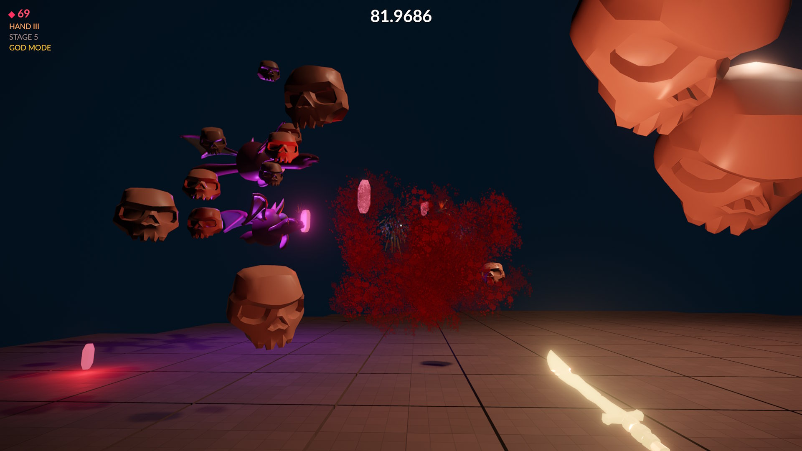

# Demon's Cove Sample

**Demon's Cove** is a small arena shooter. The player survives as long as possible on a floating platform while waves of enemies attack. Daggers kill the enemies, enemies drop gems and collected gems upgrade the player's weapon.

The game was built by an AI agent using the editor's [MCP server](../docs/tools/mcp-server.md). Starting from a few provided assets, the agent set up the project, imported the assets, wrote the C++ game plugin and iterated on the gameplay until it worked. The game design is a replica of [Devil Daggers](https://store.steampowered.com/app/422970/Devil_Daggers) by Sorath.

The sample can be downloaded directly from the ezEditor [dashboard](../docs/editor/dashboard.md). It contains a C++ plugin, which the editor offers to compile when the project is opened. Afterwards open `Scenes/Main.ezScene` and [play the game](../docs/editor/run-scene.md).

The controls, enemy types, debug CVars and the code structure are described in the [GitHub repository](https://github.com/jankrassnigg/demons-cove).

## See Also

* [Samples](samples-overview.md)
* [MCP Server](../docs/tools/mcp-server.md)
* [Dashboard](../docs/editor/dashboard.md)
